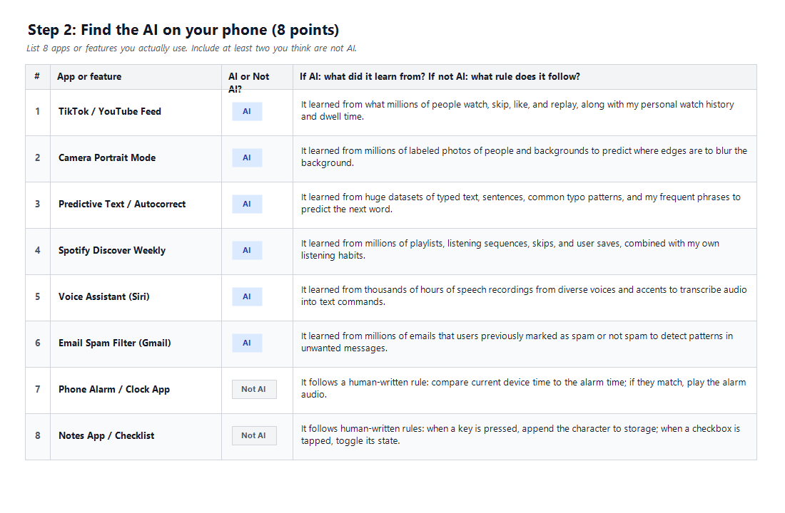

# MCCTC | 145130 Applications of AI
## Assignment 1: AI Around Me
**Week 1 · Monday · 20 points**  
**Name:** ______________________________ &nbsp;&nbsp;&nbsp;&nbsp;&nbsp;&nbsp;&nbsp;&nbsp; **Date:** November 18, 2026  
*20 points · Monday · No AI tools for this assignment.*

---

### Why you are doing this
AI is already all over your phone. Before you can build it, you need to be able to spot it, and explain how you know.

### The One Test
For every app, ask one question:
> **Did a person write the rules, or did the computer learn them from examples?**

- **If a person wrote every rule, it is not AI.** A calculator follows rules a person wrote.
- **If it learned from examples, it is AI.** Face unlock learned from photos of faces.

---

## Step 1: Warm up with three examples (3 points)
*Decide AI or Not AI for each. Write one sentence saying why, using the test.*

| Thing | AI or Not AI? | Why |
|---|---|---|
| **A calculator app** | **Not AI** | A human programmer wrote exact mathematical rules and instructions for every operation, so it follows written rules rather than learning from examples. |
| **Face unlock on a phone** | **AI** | It learned to identify facial features and recognize my face by training on thousands of face photo examples, rather than following rigid handwritten rules. |
| **A timer that beeps after 5 minutes** | **Not AI** | A person wrote the rule telling the computer to count down the seconds and sound a chime when the counter reaches zero, so it follows human-written instructions. |

---

## Step 2: Find the AI on your phone (8 points)
*List 8 apps or features you actually use. Include at least two you think are not AI.*  
*For each one, fill in the row. If you are not sure what it learned from, make your best guess and say it is a guess.*

| # | App or feature | AI or Not AI? | If AI: what did it learn from? If not AI: what rule does it follow? |
|---|---|---|---|
| **1** | **TikTok / YouTube Recommendations** | **AI** | It learned from what millions of people watch, skip, like, and replay, along with my personal watch history and dwell time. |
| **2** | **Smartphone Camera Portrait Mode** | **AI** | It learned from millions of labeled photos of people and backgrounds to predict where subject edges and depth boundaries are to blur the background. |
| **3** | **Keyboard Predictive Text / Autocorrect** | **AI** | It learned from huge datasets of typed text, sentences, common typo patterns, and my frequent phrases to predict the next word. |
| **4** | **Spotify Discover Weekly / Smart Shuffle** | **AI** | It learned from millions of playlists, listening sequences, skips, and user saves, combined with my own listening habits. |
| **5** | **Voice Assistant (Siri / Google Assistant)** | **AI** | It learned from thousands of hours of speech recordings from diverse voices and accents to transcribe audio into text commands. |
| **6** | **Email Spam Filter (Gmail)** | **AI** | It learned from millions of emails that users previously marked as spam or not spam to detect patterns in unwanted messages. |
| **7** | **Phone Alarm / Clock App** | **Not AI** | It follows a human-written rule: compare current device time to the alarm time; if they match, play the alarm audio. |
| **8** | **Built-in Notes App / Checklist** | **Not AI** | It follows human-written rules: when a key is pressed, append the character to storage; when a checkbox is tapped, toggle its checkmark state. |

---

## Step 3: Explain one in depth (5 points)
*Pick one app from your list that is AI. Answer in full sentences.*

**Chosen App:** TikTok / YouTube Recommendations Feed

1. **What does it predict or decide for you?**  
   It predicts which video is most likely to capture my attention and keep me watching, and it decides the exact sequence of videos to show next on my feed as I scroll.

2. **What examples do you think it learned from?**  
   It learned from billions of user interaction logs across the platform, including completion rates, re-watches, likes, shares, comments, and how quickly users swiped away from certain videos. It also learns directly from my personal viewing patterns and time spent watching different topics.

3. **What happens when it gets something wrong? Give a real example if you have one.**  
   When the algorithm gets something wrong, it misinterprets passive viewing or accidental pauses as strong interest. For example, if I put my phone down while a video about wood carving is playing to go grab water, the algorithm registers a very long watch time and mistakenly assumes I love woodworking. For the next several days, my feed gets flooded with wood-carving videos until I actively swipe them away quickly or tap "Not Interested" to teach the model better.

---

## Step 4: In your own words (4 points)
*Finish this sentence in your own words, without looking back at the slides:*

> **The difference between a regular program and AI is** that a regular program executes explicit step-by-step rules written by a human programmer, whereas an AI program discovers its own patterns and decision-making rules by learning from examples.

---

## Stretch question (not graded)
*A video game enemy chases you when you get close and runs away when its health is low. Is it AI? Use the test, and explain why people still call it "game AI."*

> Applying the test (*"Did a person write the rules, or did the computer learn them from examples?"*), this video game enemy is **not true AI**. A programmer wrote exact conditional rules into the game's code (such as `if player_distance < 10: chase()` and `if health < 20%: flee()`). The enemy never learned these behaviors from playing matches or studying combat examples.  
> 
> People still call it "game AI" because within game development, the term has historically referred to any scripted system, state machine, or decision tree that makes non-player characters (NPCs) behave in a way that feels intelligent and responsive to the player, even though it is entirely rule-based.

---

## What you turn in

### 1. Screenshots or photos
*Photo or screenshot 1: your finished Step 2 table of eight apps. Press Windows + Shift + S for a screenshot or see the generated image below.*



### 2. Review questions
*Answer in full sentences.*

1. **What is the one test for deciding whether something is AI?**  
   The one test is: *"Did a person write the rules, or did the computer learn them from examples?"*

2. **Which app on your list surprised you most, and why?**  
   Smartphone Camera Portrait Mode surprised me the most. Before learning the test, I assumed portrait blur was handled purely by physical camera hardware or simple contrast checks. Learning that it requires a machine learning model trained on millions of photos to distinguish tricky borders like frizzy hair, eyeglasses, and transparent edges showed me that AI is operating behind everyday camera features.

### 3. Your commit
1. Save this assignment, and any files you changed, in your course repository in a folder named `week01`.
2. In the terminal, run:
   ```bash
   git add .
   git commit -m "Week 1 Assignment 1: AI Around Me"
   git push
   ```
3. Ensure your repository is shared with GitHub user **`mjsekol`** (Settings → Collaborators → Add people → `mjsekol`).
4. On GitHub, open your repository and click your newest commit. Copy the link from the address bar.

**My commit link:** `https://github.com/BaconFace288/AIAroundMe/commit/d4a92aa121ec26f5064e14ccf3fb658b103eb646`

### 4. Turn it in
On Google Classroom, open this assignment, attach this document with your screenshots and commit link, and click **Turn in**.
